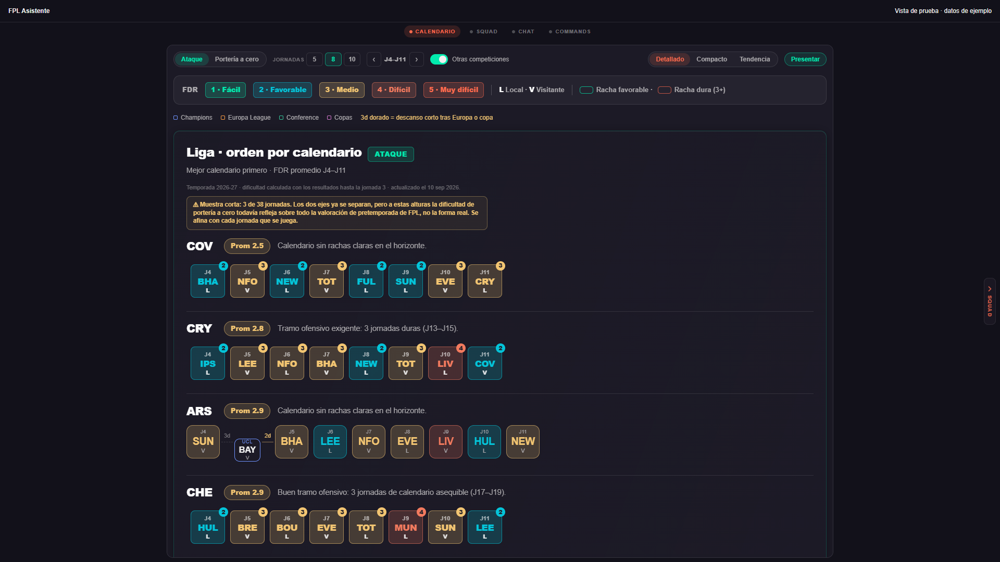

# Calendar responsive layout review

Calendar can now use up to 1280 CSS pixels instead of 720. Timeline tiles keep their existing size, order, and horizontal scrolling. Explanatory provenance and footer text retain a bounded reading width. Compact and Tendency keep their existing intrinsic chart dimensions; this change primarily benefits the detailed timeline.

Below 768 CSS pixels, duplicate lateral navigation ribbons are hidden. The top tabs and swipe remain available. Squad and Chat/Commands width caps are unchanged.

This piece starts after #463 and #464, and was rebased onto `7e61303` to preserve the later #481 presentation redesign and admin-only presentation control.

## Captures

| View | Mobile | Desktop |
| --- | --- | --- |
| Calendar | [390px controls](calendar-390.png), [390px timeline](calendar-timeline-390.png) | [1920px](calendar-1920.png), [768px tablet](calendar-768.png) |
| Squad ribbons | [Before #463](squad-pre463-390x844.png) | [Current mobile fix](squad-fixed-390x844.png) |
| Table | [390px](table-card-390.png) | [1920px](table-card-1920.png) |
| Player and mini pitch | [390px](player-card-390.png) | [1920px](player-card-1920.png) |
| Comparison | [390px](comparison-card-390.png) | [1920px](comparison-card-1920.png) |
| Defensive zones | [390px](defensive-card-390.png) | [1920px](defensive-card-1920.png) |

These captures use real components and generated Tailwind CSS in an isolated Chromium harness, with synthetic squad/competition fixtures and the repository's bundled league outlook. The header is simplified and the font uses a system fallback. Presentation access is simulated separately for admin and non-admin cases; no production access rule is changed or bypassed. This is not an authenticated end-to-end or physical-phone test. Tall rich-card screenshots increase viewport height to show the whole card after checking bounds at the normal height.

## Results

On source commit `067ae98`, full frontend Jest passed 54 suites, 754 tests, and 3 snapshots (`npm test -- --runInBand`). TypeScript (`npx tsc --noEmit`), `git diff --check`, and independent code review passed.

[Browser results](browser-results.json) record 64 passing checks/observations:

- Calendar bounds and detailed/compact/tendency views at 390, 768, 1366, 1920, and 2560 CSS pixels, without page overflow.
- Width comparison at 720/1120/1280: visible timeline width grows from 644 to 1204 pixels while Premier tiles remain 64 pixels wide.
- Horizons 5/8/10, competition detail on tap and Escape, competition switch and persistence, presentation entry/exit, Free-tier opponent privacy, and non-admin presentation control visibility.
- Before/after Squad comparison at 390x844 and 390x520. Ribbons occupied the bench region before #463 as well as afterward. These particular fixtures did not show a geometric intersection with individual player button rectangles, so this does not claim identical player occlusion on every device. The new mobile layout removes the overlay entirely; all four substitutes remain selectable without screen navigation.
- Table, player/mini-pitch, comparison, and defensive-zone cards remain within the existing Chat width at 390 and 1920 pixels.
- Native touch scroll stays within the timeline, including both ends; native pinch reaches scale 5 without changing screens. Chromium's browser-history overscroll gesture was disabled for these pager-specific touch tests; OS/browser Back gestures are not covered.
- No runtime errors in the desktop/responsive component session.

The mobile defensive-zones header still has the previously recorded label/badge overlap; the card is unchanged here and belongs to the later Chat/cards work. Mobile comparison and table retain their existing horizontal scrolling.

## Preview review

1. In Calendar, compare 5/8/10 gameweeks and toggle other competitions. On a wide screen, more matches should be visible without enlarged tiles.
2. At 390px, scroll the timeline horizontally to both ends; the selected app screen must remain Calendar.
3. In Squad, tap every substitute and use top tabs to navigate. No lateral ribbon should cover the bench.
4. On a physical phone, verify pinch, vertical scrolling, canceled swipes, and normal top-tab navigation.
5. With an authorized admin account, verify Presentar and Salir still work. Non-admin accounts should retain the current absence of Presentar.

Chat/Commands remains a separate follow-up after this PR is merged by the maintainer. No merge or auto-merge is performed by this workflow.
