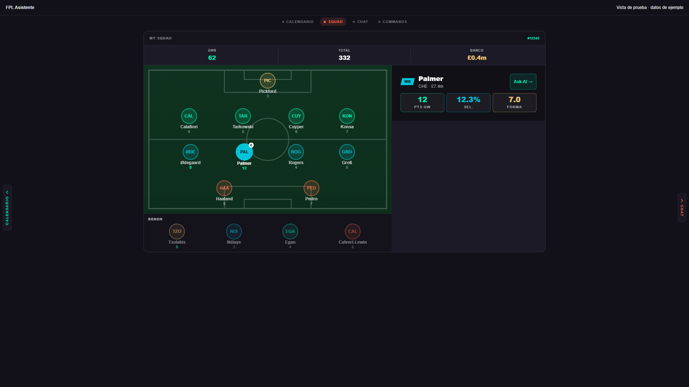
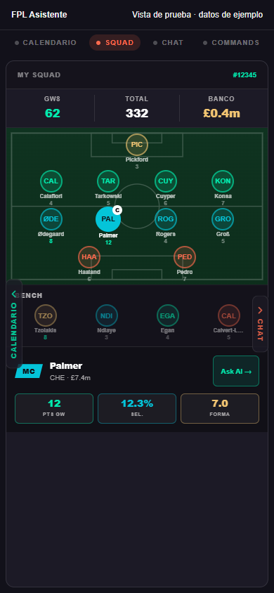

# Squad responsive layout preview

The Squad panel now uses up to 1120 CSS pixels. At a panel width of 800 pixels or more, formation and bench sit beside the selected player's details. Below that threshold, the same elements stack vertically. The pitch retains its 5:3 ratio and a maximum width of 690 pixels. The wide panel fits its content and remains scrollable in short windows.

Selection, deselection, bench selection, and Ask AI use the existing interaction. Player controls have full accessible names, pressed state, visible keyboard focus, and at least 44-pixel touch targets.

## Visual evidence

These are Chromium captures of the actual repository components and generated Tailwind CSS in an isolated test harness. All player data is synthetic. The harness uses a simplified header and a system font fallback; these are component-layout checks, not authenticated end-to-end screenshots or physical-device tests. The production Vercel preview should also be reviewed on a phone.

| View | Mobile, 390 CSS px | Desktop, 1920 CSS px |
| --- | --- | --- |
| Squad | [Mobile](squad-390x844.png) | [Wide](squad-1920x1080.png) |
| Table | [Mobile](table-card-390.png) | [Wide](table-card-1920.png) |
| Player card and mini pitch | [Mobile](player-card-390.png) | [Wide](player-card-1920.png) |
| Comparison | [Mobile](comparison-card-390.png) | [Wide](comparison-card-1920.png) |
| Defensive zones | [Mobile](defensive-card-390.png) | [Wide](defensive-card-1920.png) |

Tall card captures use an expanded viewport height to include the complete card. Width and overflow assertions run first at 390x844 or 1920x1080. Chat remains capped at 672 pixels; only the Squad width changes in this PR.

The mobile defensive-zones capture also exposes an existing tight header: its badge overlaps the section label with this sample text. That component and its width are unchanged here; this is a follow-up for the separate Chat/cards layout PR. Mobile comparison and table captures retain their existing horizontal scrolling.

## Validation

On source commit `0c061b6`, the full frontend Jest run passed 53 suites, 734 tests, and 3 snapshots (`npm test -- --runInBand`). `npx tsc --noEmit` and `git diff --check` also passed. An independent source review found no blocking issues.

The attached [browser results](browser-results.json) record 22 passing checks:

- Geometry at 390x844, 810x700, 830x700, 1366x768, 1920x1080, 2560x1080, 390x520, and 1366x400: preserved selection, correct stacked/adjacent layout, 5:3 pitch, no overlapping player controls, and no page overflow.
- Bench and Ask AI are reachable by scrolling in the 1366x400 window.
- Selecting a bench player replaces the detail; Ask AI navigates to Chat with the exact existing question.
- All four rich-card types stay within the existing Chat width at 390 and 1920 pixels.
- A five-defender formation fits at the narrow desktop transition.
- Native Chromium touch input zooms the Squad view without changing screens.
- No runtime page errors.

Four Jest tests cover starter selection/deselection, replacing the selection with a bench player and asking AI, preserving the same detail through a resize event without refetching, and clearing selection when the connected team changes. Browser geometry checks complement Jest because jsdom does not perform layout.

## Preview review steps

1. Connect a team and open Squad. Select a starter, then a substitute; check the detail and Ask AI question.
2. Resize from a wide desktop to 390 pixels while a player is selected. The detail should move beneath the bench without losing selection.
3. Try a short desktop window and scroll to the bench and Ask AI.
4. On a phone, pinch to zoom, pan while zoomed, then zoom back out. Selection should not unexpectedly navigate to another screen.
5. Inspect table, player/mini-pitch, comparison, and defensive-zone responses in Chat at mobile and wide desktop sizes.

Calendar and Chat/Commands redesigns remain separate follow-up PRs, each starting only after the preceding PR is merged by the maintainer.
